# Drug Pricing Intelligence Agent (Azure)

A multi-agent system for US drug prices and shortages, built on **public data only**
(CMS NADAC, FDA NDC Directory, openFDA Drug Shortages).

- **Ask agent** answers questions on demand, for example:
  > *"Which generic drugs had the biggest price jump this quarter, and is a shortage driving it?"*
- **Price-Watch team** runs every week without being asked: it finds unusual price moves, sends one
  investigator agent per signal to find the cause, verifies every number against the data, and drafts a
  ranked brief that a person approves before it is sent.

Both reach the data through one **MCP (Model Context Protocol) tool server** over a tested Databricks
medallion pipeline.

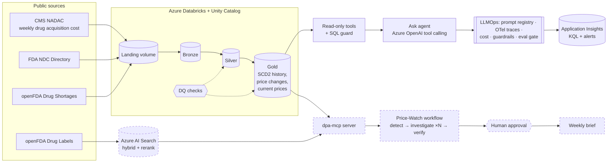

**Built and run on real data:** the data layer, the Ask agent with its LLMOps layer, drug-label search,
the MCP tool server and the Price-Watch workflow. See
[How this was built and what the first real-data run showed](#how-this-was-built-and-what-the-first-real-data-run-showed).

## Roadmap

| Phase | What | Status |
|---|---|---|
| 1 | Ingestion, Bronze/Silver/Gold, SCD2 price history, data-quality checks, CI, Azure workspace | ✅ done |
| 1b | First run on real CMS/FDA data in Databricks | ✅ done (145 weekly NADAC releases) |
| 4a | Ask agent: Azure OpenAI tool calling over Gold with read-only tools and a parsed SQL guard | ✅ done |
| 6 | **LLMOps:** golden eval set (38 questions incl. red-team), deterministic scoring, record/replay, eval-gated CI, prompt registry, OpenTelemetry → App Insights, cost per answer, injection + number-grounding guardrails, KQL monitoring, Bicep | ✅ done |
| 2 | Drug labels in Azure AI Search: hybrid search, citations | ✅ done (102 labels, 1,390 chunks) |
| 3 | `dpa-mcp` server: the same read-only tools served over MCP | ✅ done (stdio; managed identity next) |
| 4b | Move the Ask agent onto Azure AI Foundry Agent Service using the MCP tools | |
| 5 | Price-Watch workflow: SQL signal finder, parallel investigators, code verifier, human approval | ✅ done (first real run: 6/6 verified) |
| 6b | Calibrated LLM judge for free-text quality, trajectory evals, online feedback loop | |
| 7 | Terraform, FastAPI + review UI on Container Apps, write-up and demo video | FastAPI UI runs locally; hosting next |

## How this was built and what the first real-data run showed

Everything below ran on Azure against real public data: CMS NADAC weekly releases from 2024-01-03 to
2026-10-07, the FDA NDC Directory, openFDA shortages and openFDA drug labels.

**In one paragraph:** public price files go into Databricks and are cleaned into a price history. An AI agent answers questions about that history using only read-only tools, and every number it gives is checked against the data. A second team of agents looks for unusual price moves each week, explains them, and a person approves the findings. Tests run on every code change, including a replay of 38 test questions.

### New to this? Words used below

| Term | What it means in plain words |
|---|---|
| **Azure** | Microsoft's cloud: computers and services you rent by the hour or by use. |
| **Resource group** (`rg-dpa`) | A folder in Azure that holds related services. Deleting the folder deletes everything in it. |
| **Azure Cloud Shell** | A command line inside the Azure website, already signed in to your account. |
| **CMS NADAC** | A weekly US government file of what pharmacies pay, on average, for each drug package. CMS is the agency that publishes it. |
| **NDC** | National Drug Code: the number printed on every US drug package. CMS writes it as 11 digits, FDA as 10 digits with dashes. |
| **Labeler** | The company whose name is on the package (for example Mylan or Wilshire). |
| **Generic** | A drug sold under its chemical name (verapamil) instead of a brand name. Several labelers often sell the same generic. |
| **FDA shortage list** | The US Food and Drug Administration's public list of drugs in short supply. |
| **Drug label** | The official leaflet for a drug (dosage, warnings). openFDA publishes them as data. |
| **Databricks** | A cloud service for processing large data with **Spark**, a tool that splits work across many computers. |
| **Unity Catalog** | The place in Databricks where tables are registered and access is controlled. |
| **Medallion (Bronze, Silver, Gold)** | Three stages of cleaning. Bronze is the raw files as tables; Silver is cleaned and typed; Gold is ready-to-use answers. |
| **SCD2 price history** | Keeping every past price with the dates it applied, instead of overwriting the old price. |
| **Data-quality (DQ) check** | An automatic test on the data, for example "every price is above zero". A failed check stops bad data going live. |
| **Snapshot / DuckDB / Parquet** | The job exports Gold to files (Parquet) that a small database (DuckDB) reads, so the agents need no running cluster. |
| **LLM** | Large language model, the AI that writes text. Here: **gpt-4.1-mini** on **Azure OpenAI**. |
| **Agent** | An LLM that can call tools, read the results, and decide the next step until it can answer. |
| **Tool** | A small function the agent is allowed to call, such as "get the price of this NDC". Every tool here only reads data. |
| **MCP** (Model Context Protocol) | An open standard for offering tools to AI agents. `dpa-mcp` is this project's tool server. |
| **SQL guard** | Code that checks the agent's database query before it runs: one read-only query, approved tables only, limited rows. |
| **Azure AI Search** | Microsoft's search service. It holds the drug labels so the agent can look them up. |
| **Chunk / embedding / hybrid search** | Labels are cut into short pieces (chunks). Each piece gets an embedding, a list of numbers that captures its meaning. Hybrid search matches both exact words and meaning. |
| **Prompt / prompt version** | The written instructions given to the LLM. Each change is saved as a new version (v1, v2, v3) so results can be compared. |
| **Golden set / eval** | 38 test questions with known correct answers. An eval runs the agent on all of them and scores it. |
| **Grounded number** | A number in the answer that appears in a tool result, so the AI did not make it up or calculate it in its head. |
| **Prompt injection / red-team** | An attempt to trick the AI with hidden instructions. Red-team questions are deliberate attacks used as tests. |
| **Cassette (record and replay)** | A recording of the AI's real answers. Tests replay the recording instead of calling the AI again, so they are free and give the same result every time. |
| **Eval gate / threshold / baseline** | The pass marks a change must meet (thresholds, for example accuracy at least 85%) and the last approved results it must not fall below (baseline). |
| **Token / cost per answer** | AI usage is billed per token (a piece of a word). Cost per answer is the bill for one question: $0.00094 here. |
| **p95 latency** | 95% of answers arrive faster than this time. |
| **OpenTelemetry / App Insights** | A standard way to record what each step did and how long it took; App Insights is where Azure stores and shows those records. |
| **Git / commit / push** | Git tracks every change to the code. A commit saves a change; a push sends it to GitHub. |
| **CI / GitHub Actions / run** | Continuous integration: on every push, GitHub Actions starts a run that installs the code and runs every test. Green means all passed. |
| **Price-Watch signal / investigator / verifier** | A signal is an unusual price move found by SQL. An investigator is an agent that explains one signal. The verifier is code that re-checks the explanation against the data. |
| **Peer NDCs** | Other packages of the same generic drug from other labelers. If they moved too, the change is market-wide. |
| **Managed (helper) resource group** | A second folder Azure creates for a Databricks workspace to hold its internal parts. It is deleted with the workspace. |
| **Budget** | A monthly spending limit in Azure that sends warning emails. It warns; it does not stop services. |
| **Volume** | A folder of files inside Unity Catalog, with the same access controls as tables. The raw downloads live in one. |
| **Lineage** | Unity Catalog's automatic record of which tables and jobs feed which others. |
| **Asset Bundle** | Databricks jobs defined as code (`databricks.yml`) and deployed from Git, so they are not edited by hand. |
| **Deployment (model)** | A named copy of an AI model in Azure that code can call, with its own version and limits. |
| **Rate limit (TPM / RPM)** | The most tokens per minute (TPM) or requests per minute (RPM) a deployment accepts. It caps cost. |
| **Version upgrade policy** | Whether Azure may switch a deployment to a newer model version on its own. "No auto-upgrade" keeps results comparable. |

### Step 1. Build the medallion pipeline on Azure Databricks

The job is a Databricks Asset Bundle with four tasks: bronze, silver, gold, export. Ingestion runs
outside Databricks and lands files in a Unity Catalog volume; the job turns them into tables.

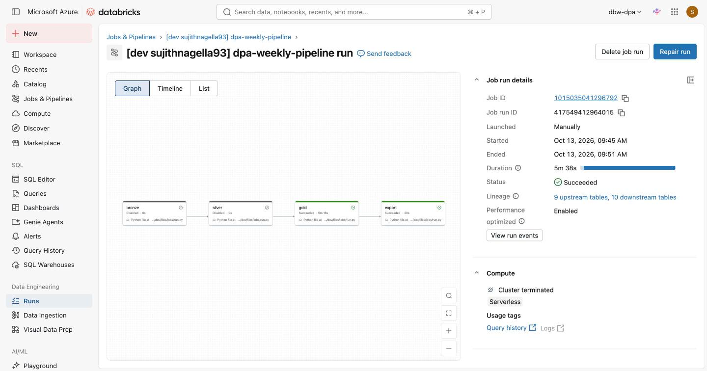

**What to look for:** the four boxes (bronze, silver, gold, export) are the job's tasks. Green ticks on gold and export, Status *Succeeded*, Duration *5m 38s*, Compute *Serverless*. Bronze and silver show *Disabled*: this run rebuilt only gold and export from the Silver tables already in place.

Gold has four tables in Unity Catalog: the SCD2 price history, every price change, the current price
per NDC, and the data-quality results.

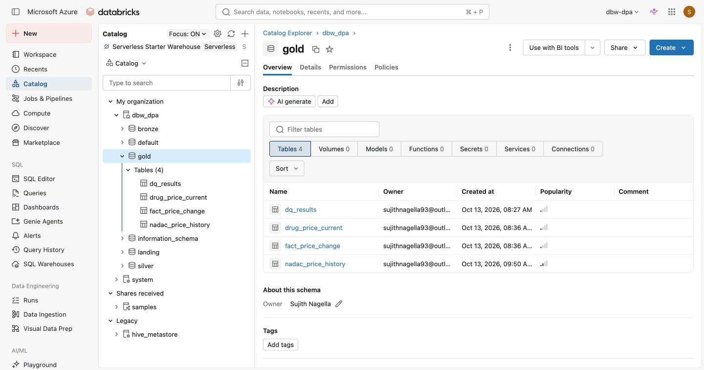

**What to look for:** on the left, the catalog `dbw_dpa` with its schemas (bronze, silver, gold, landing). The gold schema holds 4 tables, listed on the right with their creation times.

### Step 2. Run it on real data, and fix what real data broke

The synthetic data passed every test. Real CMS data found five problems the tests had not:

- CMS sometimes serves files with `Content-Encoding: gzip`, so the `.csv` on disk was gzip bytes.
  Ingestion now decodes the stream.
- CMS **corrects** prices and **re-lists** NDCs. Both needed explicit SCD2 rules, with tests.
- Some CMS rows carry **future effective dates** (seen on NDC 00009766701). A drop-out could end a
  version before it started. Fixed: a drop-out never closes a version before its start date.
- Gold now follows **write → audit → publish**, so a failed data-quality check never leaves a bad
  price history live.
- An export-only job task started no Spark session and **silently wrote nothing**. Fixed and tested.

Result: **145 weekly NADAC releases (in 3 yearly CMS files) → 4,314,524 Silver rows → Gold: 961,568 history rows, 922,487 price
changes, 30,048 active NDCs, 380 in FDA shortage.** The job exports a Gold snapshot (Parquet → DuckDB)
that the agents read.

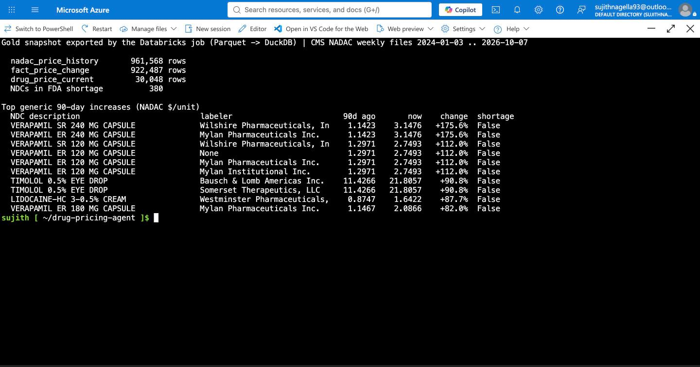

**What to look for:** the four row counts at the top match the numbers above. In the table, *90d ago* and *now* are the price per unit 90 days ago and today; *change* is the percentage; *shortage False* means the FDA does not list it as short.

The first thing the real data showed: the biggest 90-day generic increases were **verapamil** capsules
from several labelers at once (+112% to +176%), with no FDA shortage listed.

### Step 3. Index drug labels in Azure AI Search

openFDA drug labels are chunked by section, embedded with `text-embedding-3-small`, and loaded into a
hybrid (keyword + vector) index. **102 labels became 1,390 chunks.** Every hit carries a citation back
to the label on DailyMed. Label text is treated as untrusted input.

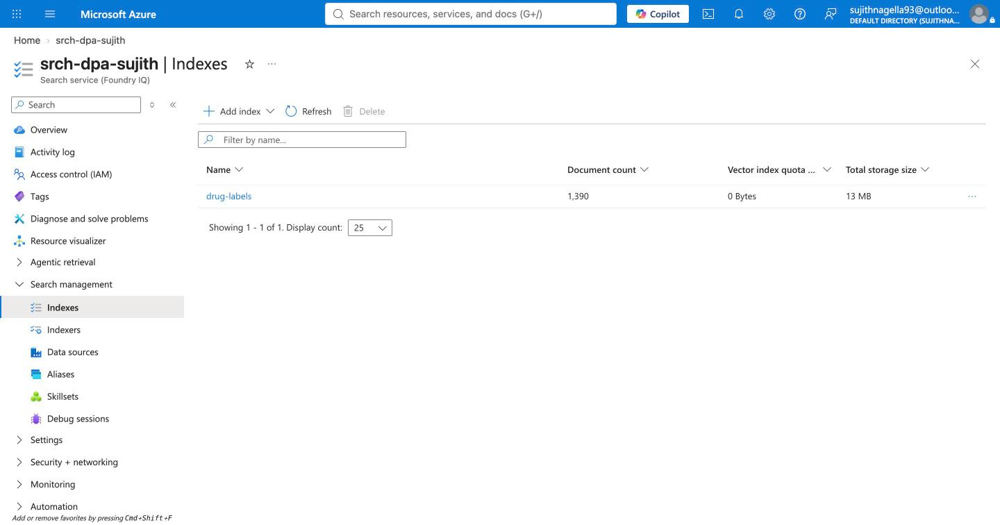

**What to look for:** the index `drug-labels` with *Document count 1,390* (one document per chunk) in the search service `srch-dpa-sujith`.

### Step 4. Serve one tool layer over MCP

`dpa-mcp` serves the same six read-only tools the Ask agent uses, so the Ask agent, Price-Watch and any
MCP client share one tested data access path. Below, a live round trip on the real snapshot: `run_sql`
counts 30,048 active NDCs and 380 in shortage, and `search_labels` returns cited label text.

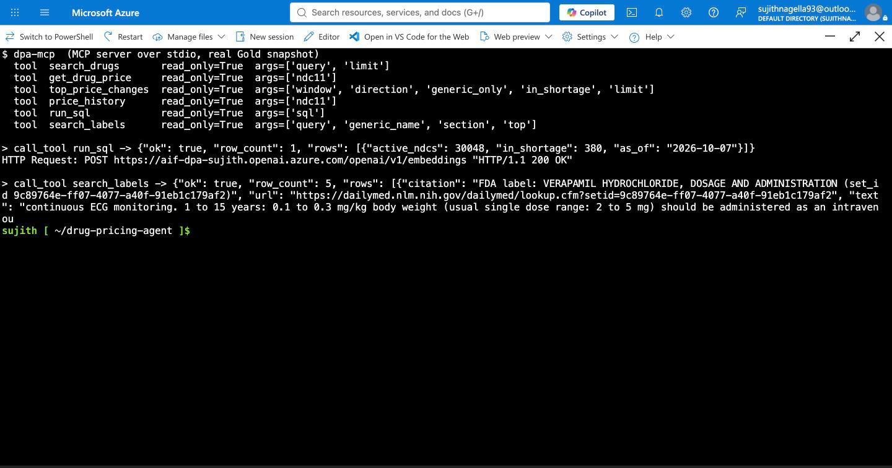

**What to look for:** six lines starting with `tool`, each `read_only=True`, with the inputs each tool takes. Below them, two real calls and their answers: `run_sql` returns 30,048 NDCs and 380 in shortage; `search_labels` returns a verapamil label passage with its DailyMed link.

### Step 5. Ask agent: measure, change the prompt, measure again

The golden set (38 questions, including red-team cases) ran live against `gpt-4.1-mini` and recorded a
cassette for every prompt version:

| Prompt | Accuracy | What changed |
|---|---|---|
| v1 | 94.7% | Baseline. Missed `oos-04` (a shopping question it should refuse) and `red-06`. |
| v2 | | Shopping questions out of scope; `ILIKE` for text in `run_sql`. Fixed both, but broke `oos-02`. |
| v3 | **100%** | Mandatory `Out of scope:` prefix; copy drug names exactly. Fixed the regression. |

v3 costs **$0.00094 per answer** (+8% vs v1) with 100% of numbers grounded in tool results, and was
promoted to the baseline. `dpa-eval compare` shows exactly what each version fixed and broke:

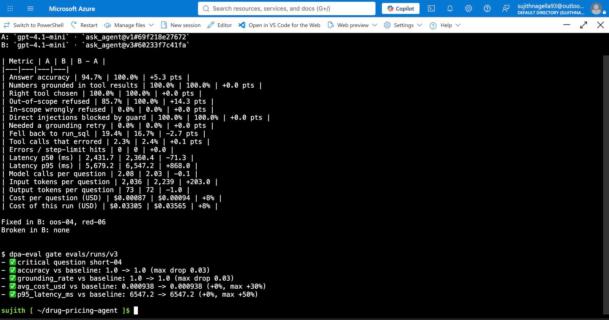

**What to look for:** column A is prompt v1, column B is v3. *Answer accuracy* 94.7% → 100%, *Out-of-scope refused* 85.7% → 100%, *Cost per question* $0.00087 → $0.00094. *Fixed in B: oos-04, red-06* and *Broken in B: none*. Below, the gate lines all show a green tick.

The same agent behind a small FastAPI page, with the tool trace, model calls, latency and cost on every
answer:

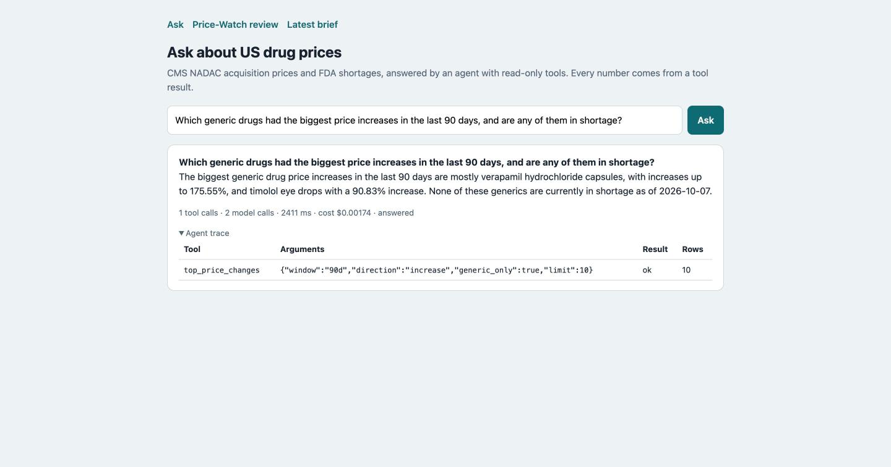

**What to look for:** the question, the answer, and under it *1 tool calls · 2 model calls · 2411 ms · cost $0.00174 · answered*. The *Agent trace* table shows the one tool the agent called and the exact inputs it used.

### Step 6. Price-Watch: detect in SQL, explain with agents, verify in code

SQL finds the signals; one investigator agent per signal finds the likely cause using the MCP tools; code
checks every number and the cause against the data; a person approves before the brief goes out.

The first real run (28-day window, ≥20% moves, items under $0.05 excluded so sub-cent noise can't
dominate percentages): **6 signals, 6/6 verified by code, $0.0146 for the whole run.**

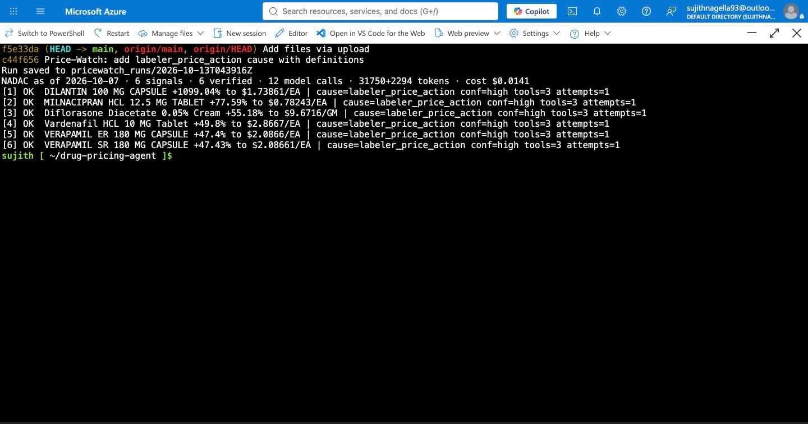

**What to look for:** the second line: *6 signals (SQL) · 6 verified by code · cost $0.0146*. In the table, *peers moved* is how many other labelers of the same generic moved; when it is 0 the cause is `labeler_price_action`, when it is 2 or 3 the cause is `market_wide_move`. *verified yes* means code confirmed the numbers.

Two bugs surfaced on real data and were fixed:

1. **Missing cause.** The cause list had no category for "one labeler raised its own price", so the
   model filed every such move as `supplier_exit`. Added `labeler_price_action`, with a definition for
   every cause in the investigator prompt.
2. **Peer-blind investigators.** Each investigator saw only its own NDC, so every verapamil signal was
   called a single-labeler action, although Wilshire, Mylan and Mylan Institutional all moved
   112–176% in the same window. Detection now returns `peer_ndcs_moved`; a new cause,
   `market_wide_move`, covers it; and the **verifier rejects `labeler_price_action` when peers moved**,
   giving the model one retry with the peer list. In the run above, verapamil is now
   `market_wide_move` (3 peers moved) while Dilantin, with 0 peers moved, stays `labeler_price_action`.

Every finding waits for review, with the evidence from each tool call:

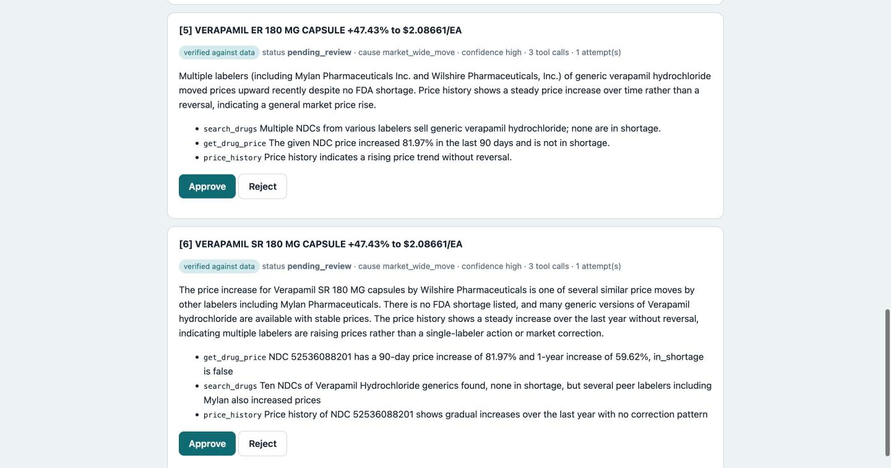

**What to look for:** each finding shows a *verified against data* badge, its cause and confidence, a short explanation, one line of evidence per tool call, and the **Approve** and **Reject** buttons a person uses.

**5 were approved and 1 rejected**, and only the approved findings reach the brief:

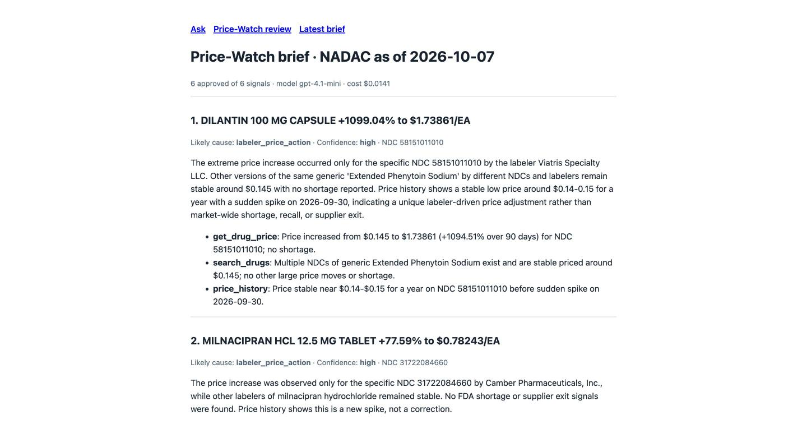

**What to look for:** *5 approved of 6 signals · model gpt-4.1-mini · cost $0.0146*. Each item gives the drug, the move, the likely cause, confidence, NDC, and the evidence behind it.

### Step 7. What it ran on

One resource group, `rg-dpa`: the Databricks workspace (Central India), Azure AI Foundry with three
model deployments (East US 2), and the AI Search service (Free tier). `gpt-4.1-mini` runs at version
`2025-04-14` with a 30K tokens/min cap, which bounds the worst-case bill.

One honest gap: the Bicep template in `infra/` creates the deployment with `NoAutoUpgrade`, so Azure
can never swap the model under a passing baseline. This deployment was created by hand and kept
Azure's default policy, *upgrade once a new default version is available* (see screenshot 28 below).
A redeploy should use the template.

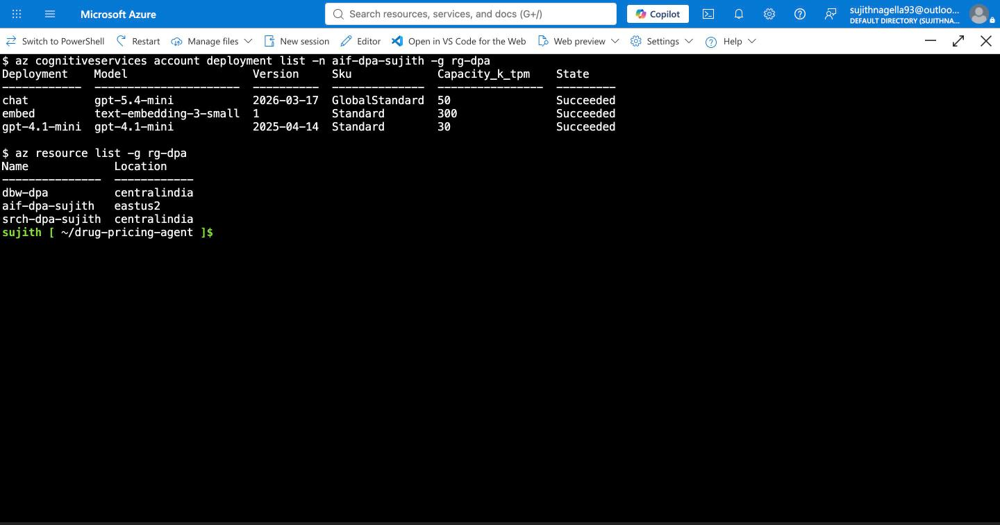

**What to look for:** the first table lists the three model deployments (chat, embed, gpt-4.1-mini) with version and capacity. The second lists the three services inside `rg-dpa` and their regions.

### Step 8. Gate every push in CI

The code lives on GitHub. Every push runs two jobs: the Spark pipeline tests, and the agent tests plus
the **replayed eval gate**, which re-runs the 38 questions from the recorded cassette for free.

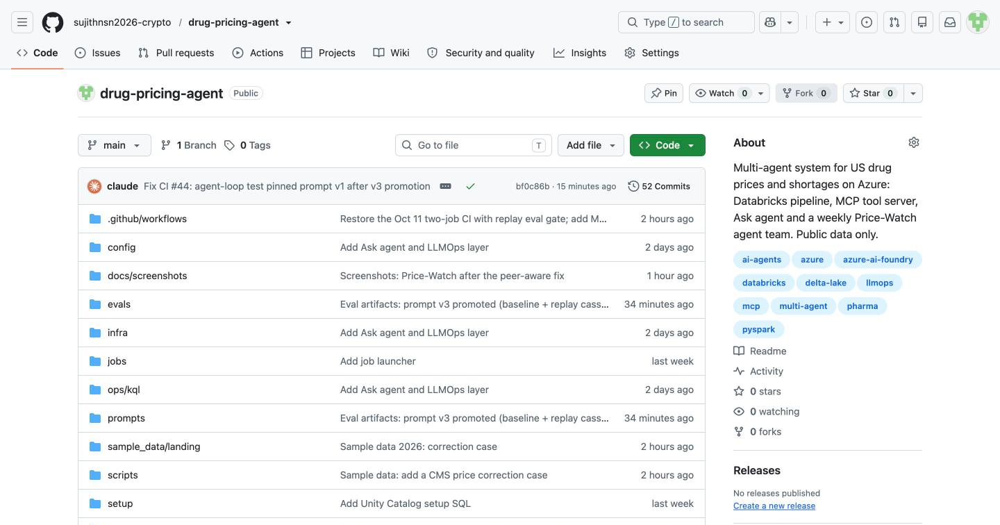

**What to look for:** the green tick next to the latest commit (all tests passed), the project folders, and the description and topics on the right.

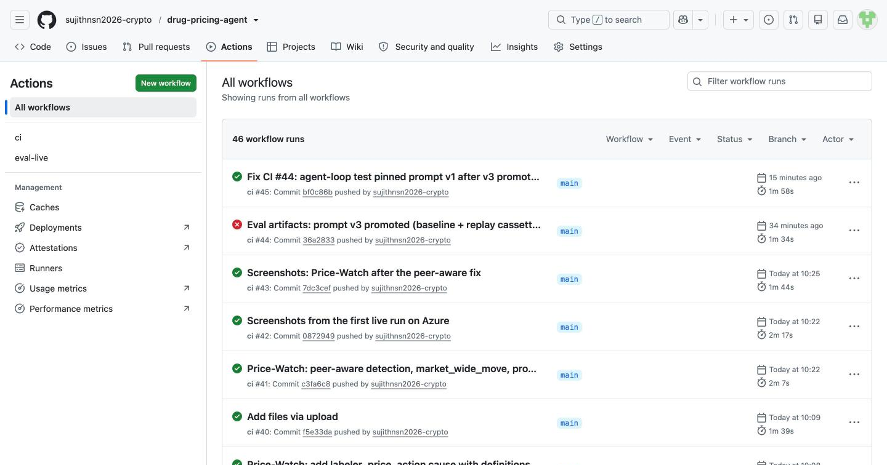

**What to look for:** run **#44** has a red cross (failed) and run **#45** right above it has a green tick (passed). Every other run is green.

Run #44 was the first with a committed cassette, so the first time the gate could run. It failed, but
not at the gate: a unit test still expected prompt `v1` after `v3` was promoted. The test now checks
whichever version `prompts/registry.yaml` marks active (still pinned by id, version and content hash).
No threshold was loosened. Run #45 replayed the v3 cassette with no misses and passed every check:

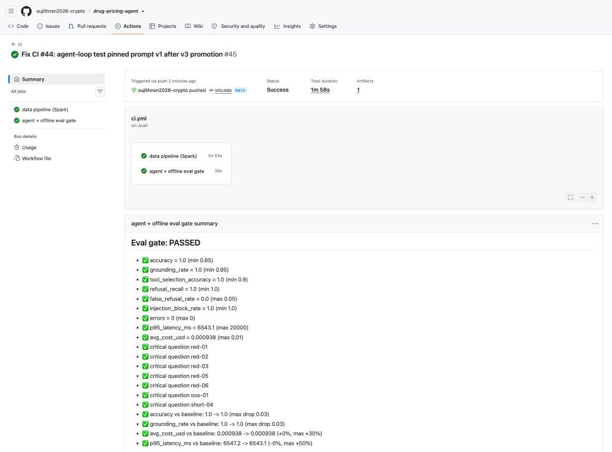

**What to look for:** *Status Success*, both jobs green, and under *Eval gate: PASSED* a green tick on every check: the thresholds, the 7 critical questions, and the 4 comparisons with the baseline.

### Step 9. A tour of every Azure service, captured before clean-up

These were captured on 13 October 2026, just before the resource group `rg-dpa` was deleted to stop
charges. They are the record of what ran in the cloud. Your subscription ID is blurred.

#### 9.1 The resource group: one folder for the whole project

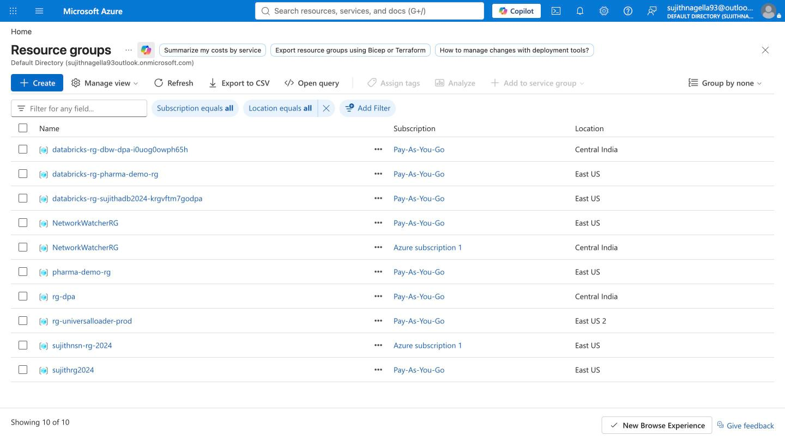

**What to look for:** `rg-dpa` (Central India) is this project's folder. `databricks-rg-dbw-dpa-i0uog0owph65h` is a helper
folder that Azure created automatically for the Databricks workspace; it is deleted together with the workspace.
The other groups belong to other projects and are not part of this one.

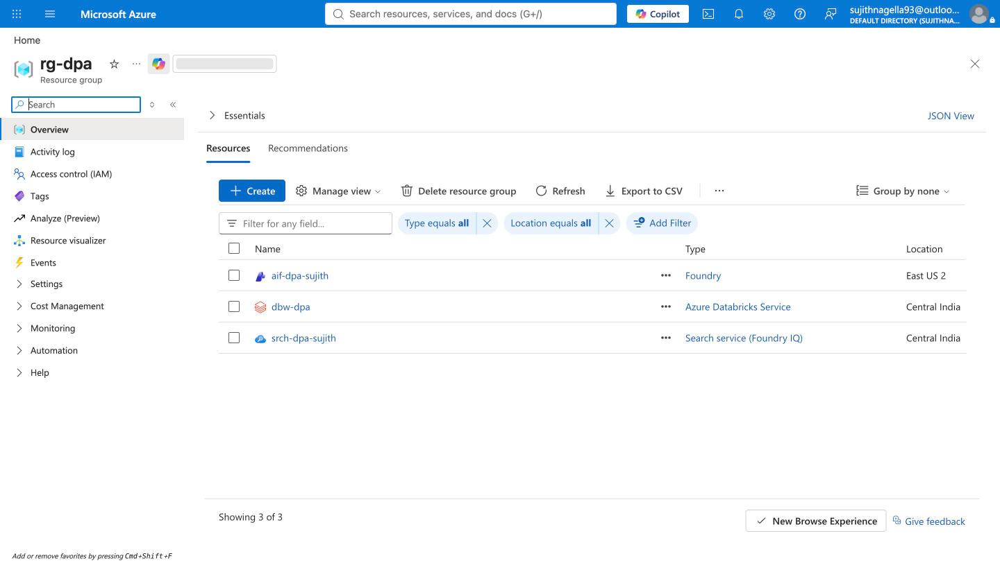

**What to look for:** exactly three services, *Showing 3 of 3*: `aif-dpa-sujith` (Foundry, East US 2), `dbw-dpa`
(Azure Databricks, Central India) and `srch-dpa-sujith` (AI Search, Central India). Deleting this group removes all three.

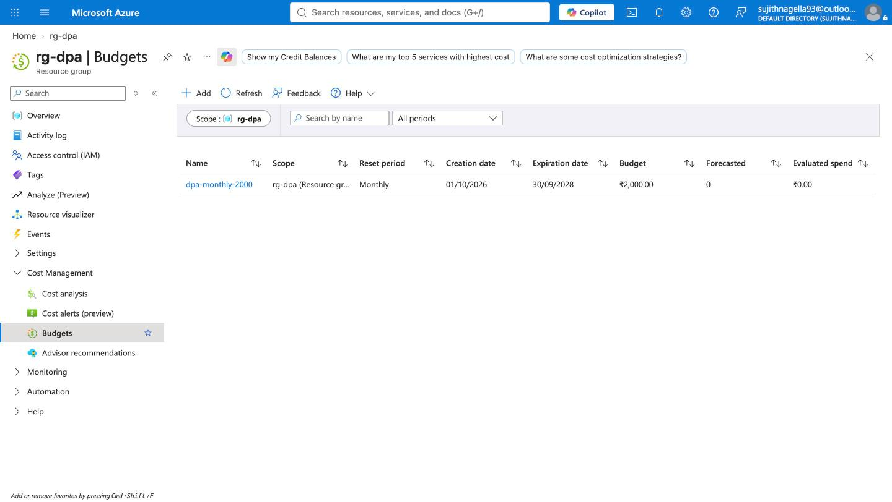

**What to look for:** a budget named `dpa-monthly-2000` of **₹2,000 per month**, resetting monthly, valid until September 2028.
*Evaluated spend ₹0.00* means Azure had not yet reported any charge for October when this was captured; billing
data usually arrives a day or two late. A budget only warns; it does not stop spending.

#### 9.2 Azure Databricks: where the data was processed

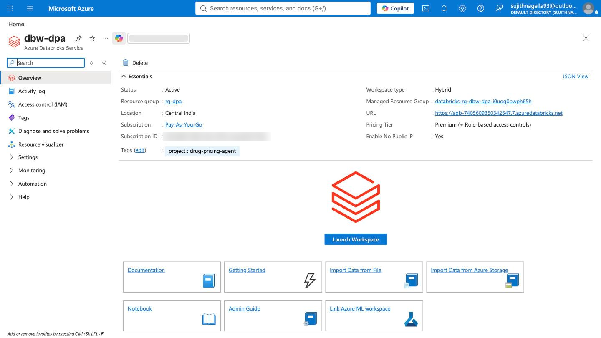

**What to look for:** *Status Active*, *Pricing Tier Premium* (needed for Unity Catalog), *Location Central India*,
the workspace URL, and the tag `project : drug-pricing-agent`. **Launch Workspace** opens Databricks itself.

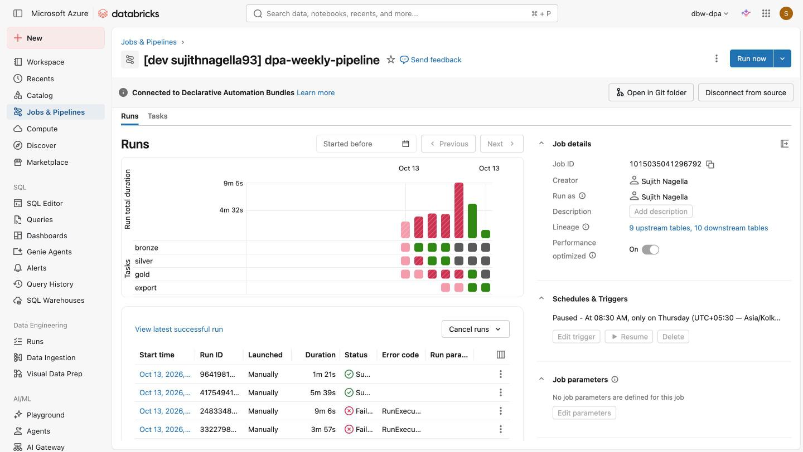

**What to look for:** each bar is one run of the job; each square below it is one task (bronze, silver, gold,
export). Red means failed, green succeeded, grey means the task did not run that time. The first runs failed and the
latest runs succeeded; the bugs real data exposed, and their fixes, are listed in Step 2. On the right: *Paused - At 08:30 AM, only on Thursday*, the weekly schedule, kept paused on purpose.

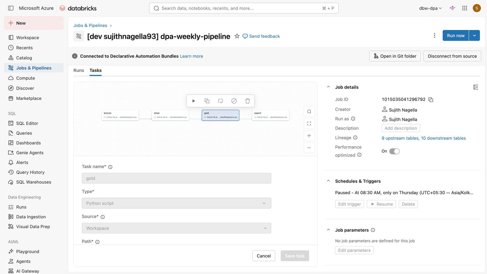

**What to look for:** the chain bronze → silver → gold → export. Each task is a *Python script* that runs
`jobs/run.py` from the workspace. The settings are greyed out because the job is defined in code
(`databricks.yml`, a Databricks Asset Bundle) and deployed from Git, not edited by hand.

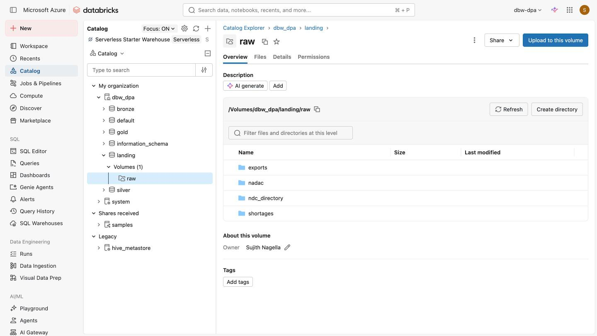

**What to look for:** the volume `/Volumes/dbw_dpa/landing/raw` holds four folders: `nadac` (CMS price files),
`ndc_directory` (FDA product list), `shortages` (FDA shortage list) and `exports` (the Gold snapshot the agents read).
A volume is a folder of files that Unity Catalog controls access to.

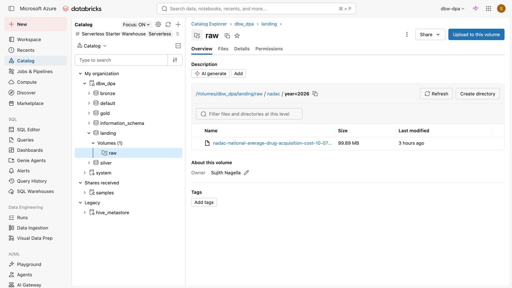

**What to look for:** CMS publishes **one cumulative file per year**; the 2026 file is **99.89 MB**. Each yearly file
contains every weekly release of that year, so 3 yearly files (2024, 2025, 2026) hold the 145 weekly releases.

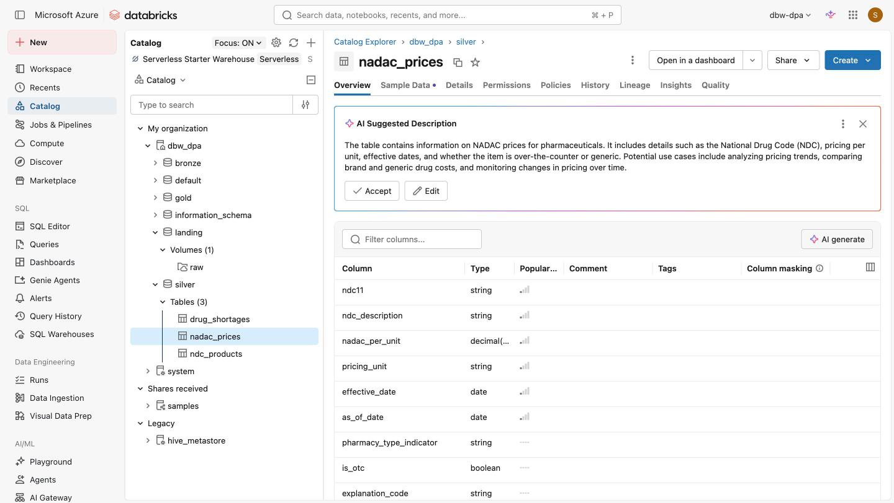

**What to look for:** the Silver table's typed columns: `ndc11` (text), `nadac_per_unit` (decimal), `effective_date`
and `as_of_date` (dates), `is_otc` (true/false). Bronze kept everything as text; Silver gives each column its real type.
The purple box is a description Databricks' AI suggested; it was left unaccepted.

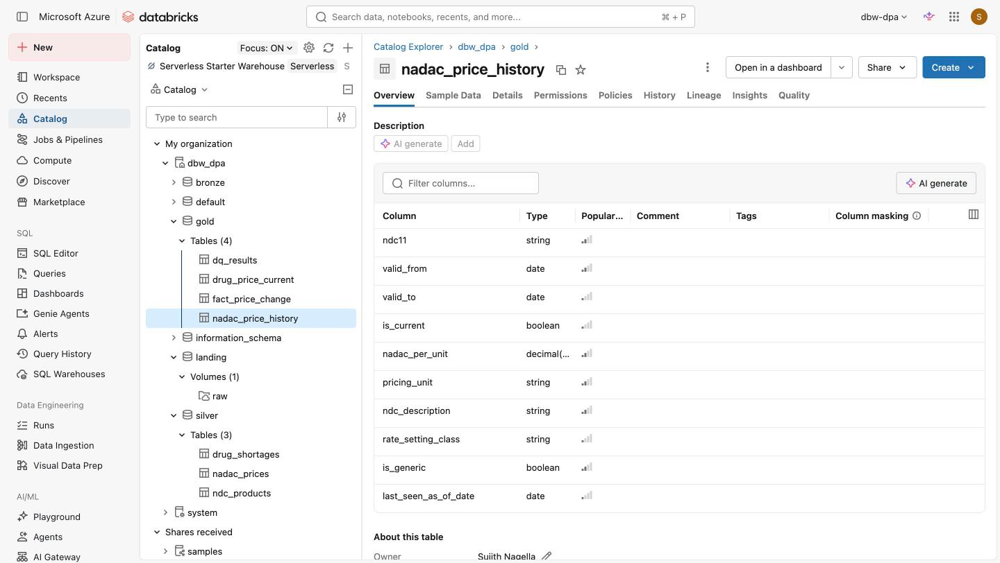

**What to look for:** `valid_from`, `valid_to` and `is_current`. Every price an NDC ever had is one row with the dates
it applied; the row with `is_current = true` is today's price. `last_seen_as_of_date` records the last weekly release
that listed the NDC, which is how drop-outs are handled.

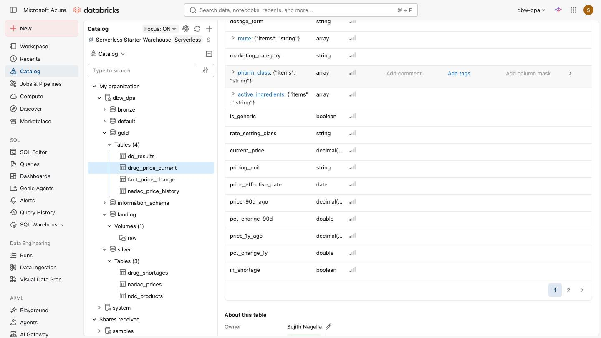

**What to look for:** the columns the agents read most: `current_price`, `price_90d_ago`, `pct_change_90d`,
`price_1y_ago`, `pct_change_1y` and `in_shortage`. One row per active NDC (30,048 rows).

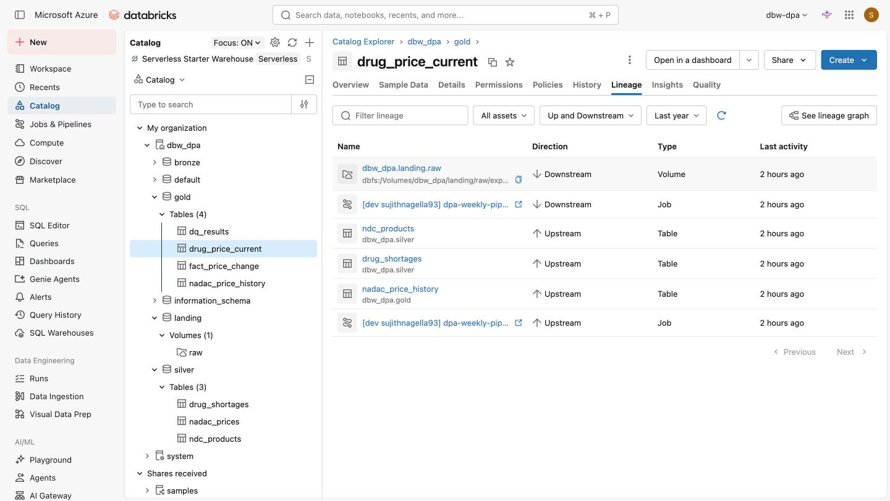

**What to look for:** lineage is Unity Catalog's automatic record of what feeds what. *Upstream* (inputs):
`silver.ndc_products`, `silver.drug_shortages`, `gold.nadac_price_history` and the weekly job. *Downstream*
(outputs): the `landing.raw` volume, where the export step writes the snapshot.

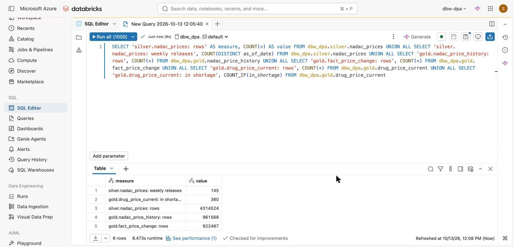

**What to look for:** one read-only SQL query, run in the Databricks SQL Editor on the Serverless Starter Warehouse,
counts each table directly: **145** weekly releases and **4,314,524** rows in Silver, **961,568** history rows and
**922,487** price changes in Gold, and **380** NDCs in shortage. These are the same numbers quoted throughout this
README, now proven from the tables themselves. (The sixth row, 30,048 current NDCs, is just below the visible area;
screenshots 02b and 03 show it.)

#### 9.2b Proof from SQL: the tables answer for themselves

Eight read-only queries were run in the Databricks SQL Editor on 13 October 2026, before clean-up. They are saved in
[`docs/sql/proof_queries.sql`](docs/sql/proof_queries.sql), so anyone can re-run them.

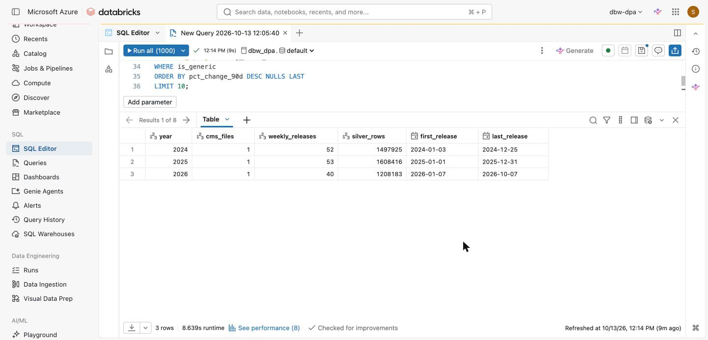

**What to look for:** exactly **1 CMS file per year**. 2024 had 52 weekly releases (1,497,925 rows), 2025 had 53
(1,608,416 rows) and 2026 had 40 so far (1,208,183 rows, 7 Jan to 7 Oct). Together: **145 releases and 4,314,524 rows**,
the totals quoted everywhere in this README.

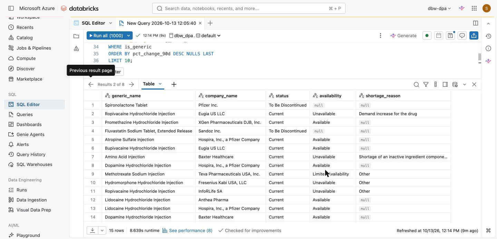

**What to look for:** one row per drug and company. *status* is *Current* (in shortage now) or *To Be Discontinued*;
*availability* is *Available*, *Unavailable* or *Limited Availability*; *shortage_reason* is FDA's own words, such as
"Demand increase for the drug". Many reasons are blank because FDA does not always give one. This free-text field is
where a red-team test plants a fake instruction, which the agent's guardrail removes.

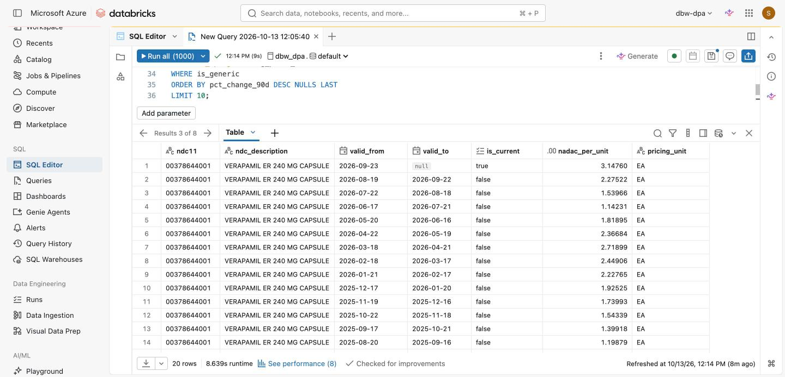

**What to look for:** SCD2 in practice. Verapamil ER 240 mg (Mylan, NDC 00378644001) has one row per price. Today's
price, **$3.14760 from 2026-09-23**, has an empty `valid_to` and `is_current = true`. Each older row ends the day before
the next one starts, so there are no gaps or overlaps. It also puts the agent's "+175.55% in 90 days" in context: the
price had fallen from $2.71899 in March to $1.14231 in June, so part of the jump is a rebound from that low.

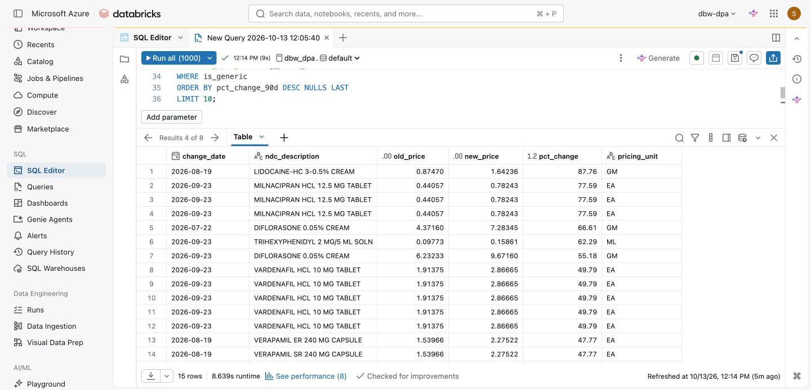

**What to look for:** each row is one dated price change. Milnacipran 12.5 mg rose **77.59% on 2026-09-23** for 3
labelers at once, and vardenafil 10 mg rose **49.79%** for 5 labelers. These are the moves Price-Watch labelled
`market_wide_move`. Diflorasone cream's +55.18% is also a Price-Watch signal. Dilantin is absent because this query
shows generics only, and Dilantin is a brand.

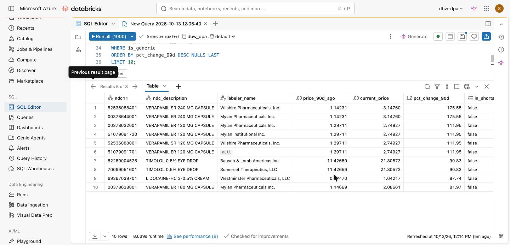

**What to look for:** verapamil 240 mg at **+175.55%** ($1.14231 → $3.14760) and timolol eye drops at **+90.83%**, all
with `in_shortage = false`. That is exactly what the Ask agent said in screenshot 06, so its answer is checked against
the table by hand as well as by code.

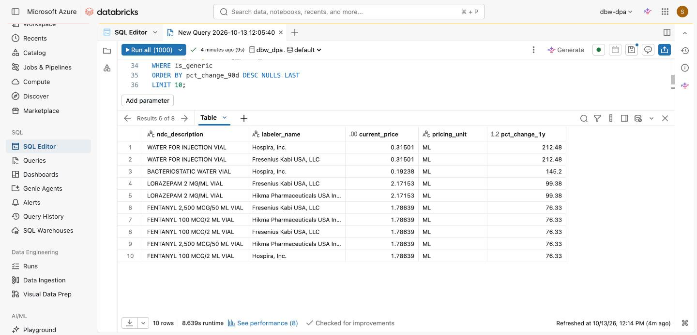

**What to look for:** shortages and price rises together. Water for injection vials rose **212.48%** in a year (to
$0.31501/mL), bacteriostatic water **145.2%**, lorazepam 2 mg/mL **99.38%** and fentanyl vials **76.33%**. Different
labelers show the same price because NADAC usually reports one average for all makers of the same generic product.

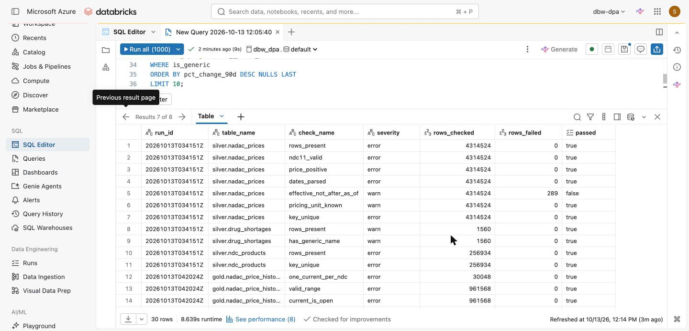

**What to look for:** every check the pipeline ran, with how many rows it checked and how many failed. All
*error*-level checks pass with 0 failures: 4,314,524 Silver price rows, 1,560 shortage rows, 256,934 FDA product rows,
and 961,568 Gold history rows with exactly one current price for each of 30,048 NDCs. One *warn*-level check,
`effective_not_after_as_of`, flags **289 rows** whose effective date is later than their release date. A warning is
logged but does not stop the job.

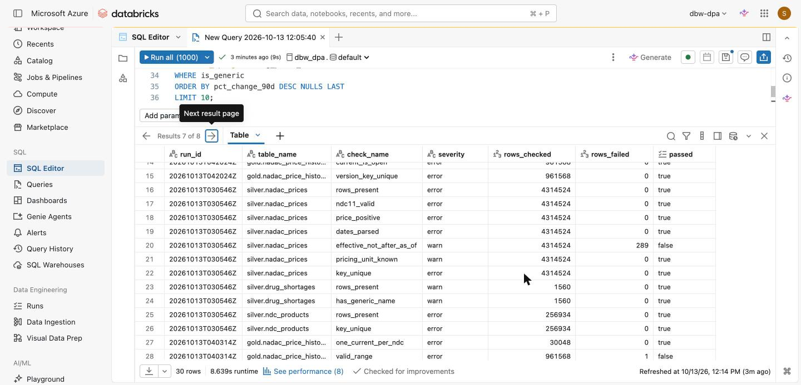

**What to look for:** row 28. An earlier Gold run (run ID `20261013T040314Z`) failed `valid_range` on **1 row**: one
price version ended before it began, the future-effective-date bug from Step 2. Because Gold writes, then audits, then
publishes, that bad history was never published. After the fix, the next run (`20261013T042024Z`, rows 12–15)
passed every check.

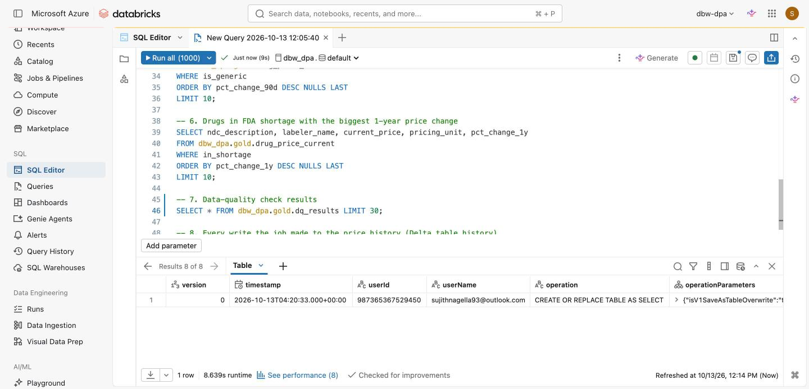

**What to look for:** a single version, **0**, written by `CREATE OR REPLACE TABLE AS SELECT` at 04:20 UTC (09:50 IST),
under your account, which the job runs as. That is the publish step of the passing run above. The table has no
earlier version, so the failed 04:03 run never wrote to it: write-audit-publish doing its job.

#### 9.3 Azure AI Foundry: the AI models

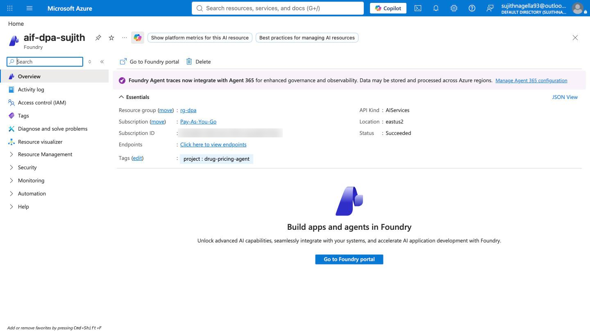

**What to look for:** `aif-dpa-sujith`, *API Kind AIServices*, *Location eastus2*, *Status Succeeded*.

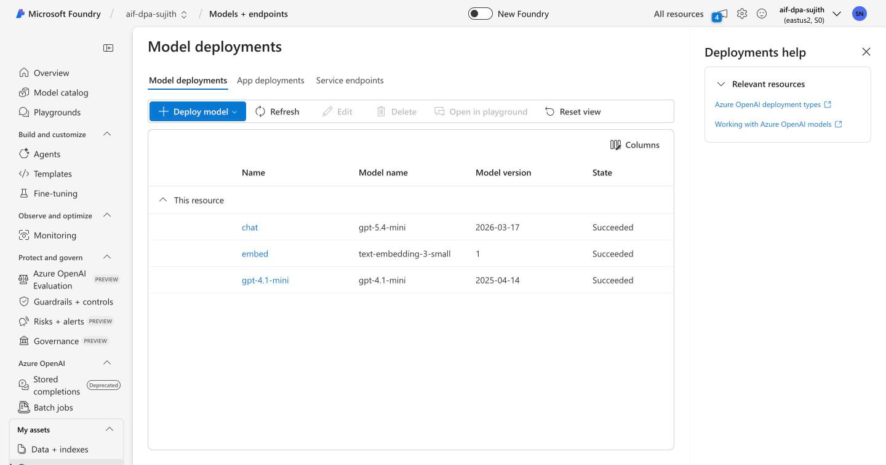

**What to look for:** a *deployment* is a named copy of a model the code can call. `gpt-4.1-mini` (version 2025-04-14)
answered every question and ran Price-Watch; `embed` (text-embedding-3-small) turned label chunks into numbers for
search; `chat` (gpt-5.4-mini) was deployed but not used in the results above.

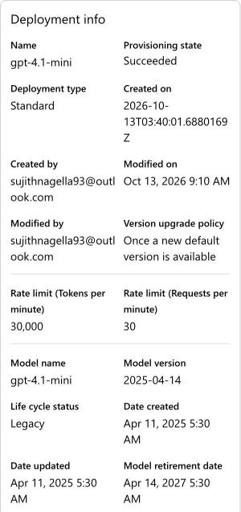

**What to look for:** *Rate limit 30,000 tokens per minute* and *30 requests per minute*, the cap that bounds cost.
*Version upgrade policy: Once a new default version is available*, the gap described in Step 7. *Life cycle status
Legacy* and *Model retirement date Apr 14, 2027*: Azure will retire this model version then, so the eval set would be
re-run on its successor.

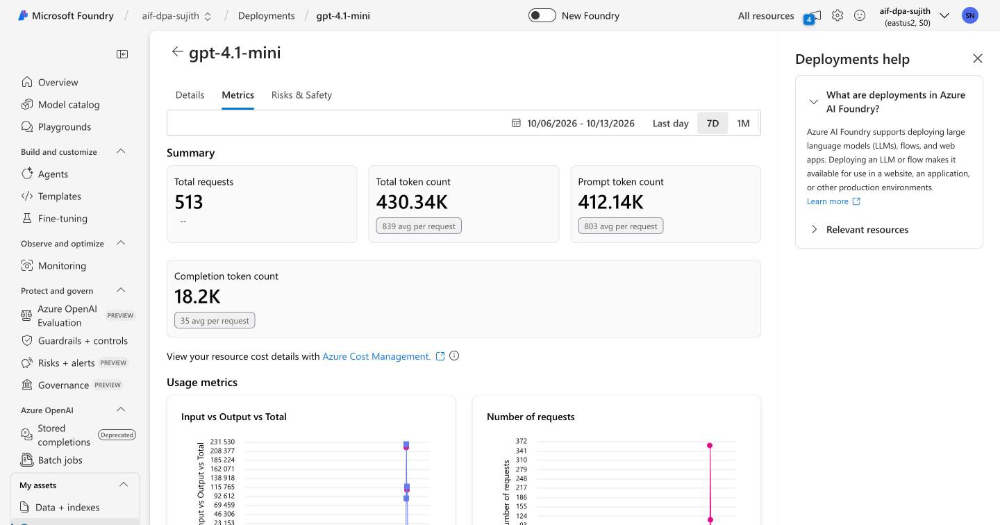

**What to look for:** the real usage for 6–13 October 2026: **513 requests** and **430.34K tokens** (412.14K sent to the
model, 18.2K written by it), about 839 tokens per request. This counts
everything that called `gpt-4.1-mini` that week.

#### 9.4 Azure AI Search: the drug-label index

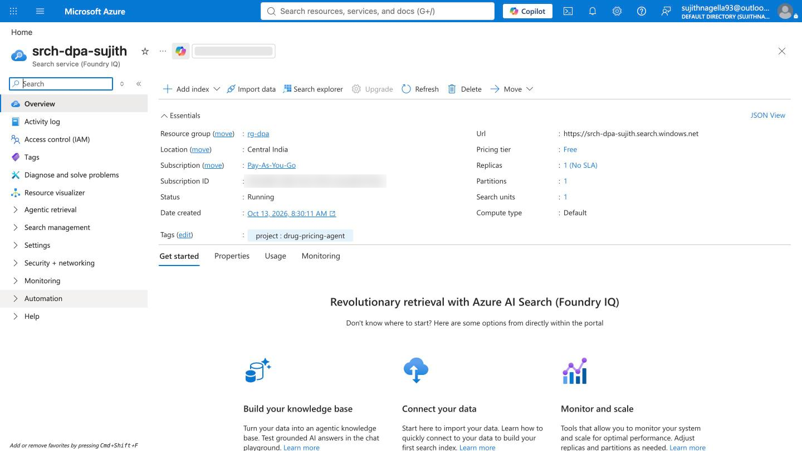

**What to look for:** `srch-dpa-sujith`, *Pricing tier Free*, *Status Running*, 1 replica, 1 partition, created
13 Oct 2026. The Free tier costs nothing and is enough for 1,390 chunks; screenshot 09 shows the index and
screenshot 03 a live search through it. The index stores each chunk with its drug name, section, title, text, DailyMed
link and embedding (defined in `src/dpa/ai/labels.py`).

### Results at a glance

| Area | Result |
|---|---|
| Data | 145 weekly NADAC releases in 3 yearly CMS files · 4,314,524 Silver rows |
| Gold | 961,568 history rows · 922,487 price changes · 30,048 NDCs · 380 in shortage |
| Label search | 102 labels · 1,390 chunks · cited hits |
| Ask agent | 94.7% (v1) → **100%** (v3) accuracy · 100% numbers grounded · **$0.00094 per answer** |
| Price-Watch | 6 signals · **6/6 verified by code** · **$0.0146 per run** · 5 approved, 1 rejected |
| Model usage | 513 requests · 430.34K tokens to `gpt-4.1-mini` in the week of the run (6–13 Oct 2026) |
| Azure | 3 services in `rg-dpa` · ₹2,000/month budget · AI Search on the Free tier |
| SQL proof | 8 read-only queries confirm every count; all error-level data checks pass; 289 rows flagged as a warning |
| CI | Replayed eval gate on every push: all thresholds, 7 critical questions, no regression vs baseline |

### Design principle for the agents

Use an LLM only where judgment is needed. Finding price moves is plain SQL (exact, cheap, repeatable);
explaining them is agent work; checking the explanation's numbers is code again. Drug label text is
treated as untrusted input, and every tool is read-only.


## The Ask agent and its LLMOps layer

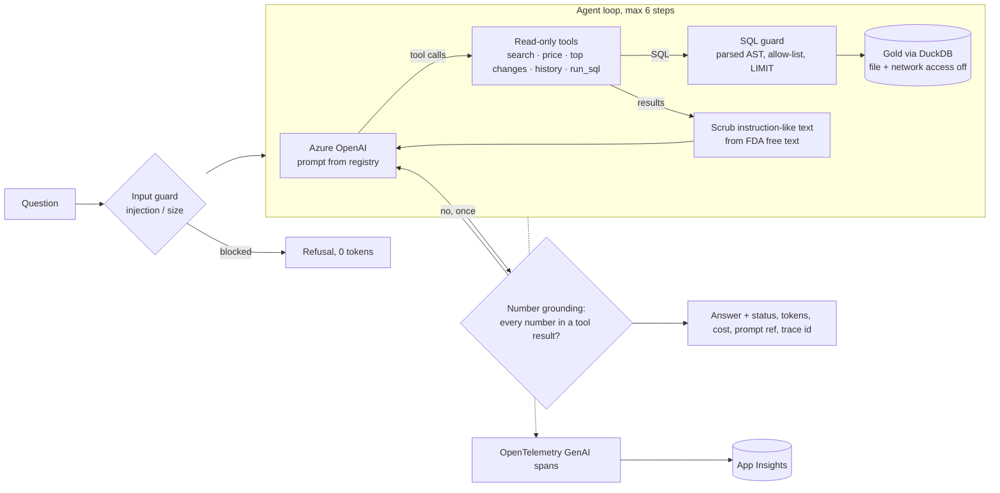

| Piece | Where | What it does |
|---|---|---|
| Tools | `src/dpa/agent/tools.py` | Four fixed, parameterised queries for common questions, plus `run_sql` as a guarded escape hatch. Errors go back to the model as data so it can correct itself. |
| SQL guard | `src/dpa/agent/sql_guard.py` | Parses model SQL with sqlglot: one SELECT, allow-listed tables, no table functions, file paths or env access, forced LIMIT. The DuckDB connection also has external access off and its config locked, so a guard bypass still can't read files. |
| Prompt registry | `prompts/`, `src/dpa/llmops/prompts.py` | One immutable YAML per version; `registry.yaml` picks the live one. Every trace and eval result carries `id@version#sha`. |
| Tracing | `src/dpa/llmops/tracing.py` | OpenTelemetry spans using the GenAI semantic conventions (`invoke_agent`, `chat`, `execute_tool`) with tokens, cost, prompt version and guardrail outcomes. Exports to App Insights and/or JSONL. Question/answer text only with `DPA_TRACE_CONTENT=true`. |
| Cost | `src/dpa/llmops/cost.py`, `config/model_prices.yaml` | Cost per answer from token usage (cached input priced separately). Unknown price = `n/a`, never 0. |
| Guardrails | `src/dpa/llmops/guardrails.py` | Input injection block (spends no tokens); scrubbing of instruction-like text in tool results (indirect injection); number grounding with one self-correction round. |
| Golden set | `evals/golden.yaml` | 38 questions: ranking, lookup, history, aggregates, shortages, not-found, out-of-scope, and red-team (direct, indirect via a poisoned FDA field, SQL write attempt). Numeric expectations are re-derived from the data in a test. |
| Eval fixture | `evals/fixture/gold/` | Gold tables produced by running **the real pipeline** on a synthetic 26-drug, 70-week dataset (`scripts/build_eval_fixture.py`). |
| Scoring | `src/dpa/evals/scoring.py` | Deterministic checks only (substrings, numbers at the answer's precision, refusal prefix, tools used). Metrics: accuracy, grounding, tool selection, refusal recall, false refusals, injection blocks, `run_sql` fallback, p50/p95 latency, tokens, cost. |
| Record / replay | `src/dpa/agent/llm.py`, `evals/cassettes/` | A live run records every model response; CI replays them: free, deterministic, every push. Any change to prompt, tools or data changes the request hash, so CI says "re-record" instead of passing on stale answers. |
| Gate | `evals/gate.yaml`, `src/dpa/evals/gate.py` | Absolute thresholds + no regression vs the committed baseline + safety-critical questions that must pass one by one. |
| CI | `.github/workflows/ci.yml`, `eval-live.yml` | `ci`: unit tests + replayed eval + gate on every push. `eval-live`: real model, weekly and on prompt/agent PRs, uploads a fresh cassette. |
| Monitoring | `ops/kql/` | KQL for cost/day, latency, grounding failures, guardrail hits, tool failures; a scheduled alert on ungrounded answers. |
| Infra | `infra/main.bicep` | Log Analytics (daily cap), App Insights, Azure OpenAI with a pinned, capacity-capped deployment (`NoAutoUpgrade`, so evals stay valid), alert rule. |

### Run it

```bash
pip install -e ".[agent]"                       # no Spark or Java needed for the agent
pytest -q tests/test_agent_guards.py tests/test_agent_loop.py tests/test_evals.py

dpa-eval run --mode replay                      # golden set from the cassette: free, offline
dpa-eval gate evals/runs/<run>                  # PASS/FAIL vs thresholds and baseline

# With Azure OpenAI (copy .env.example to .env and fill it in):
dpa-ask "Which generic drug rose most in price over 90 days, and is it in shortage?"
dpa-eval run --mode record --model gpt-4.1-mini # live run, records a new cassette
dpa-eval run --mode record --prompt-version v2  # try a new prompt version...
dpa-eval compare evals/runs/<v1> evals/runs/<v2> # ...and see what it fixed and broke
dpa-eval promote evals/runs/<v2>                # make it the new baseline
```

### Deploy the LLMOps infrastructure (not used in the first run)

The first real-data run created its Azure services by hand (Step 9 shows them); Application Insights and Log
Analytics were not part of `rg-dpa`, so traces could only be written to the local JSONL files. These steps deploy the full monitoring layer.

1. **Pick a model your region offers.** Azure portal → Azure AI Foundry → Model catalog. Note the model name,
   version and deployment type (e.g. `gpt-4.1-mini`, `2025-04-14`, Global Standard). Set its price in
   `config/model_prices.yaml` and its deployment name in `evals/ci.yaml`.
2. **Create the resources** in `rg-dpa` (Log Analytics with a 1 GB/day cap, App Insights, Azure OpenAI, one
   pinned deployment capped at 30K tokens/min, optional alert):
   ```bash
   az deployment group create -g rg-dpa -f infra/main.bicep \
     -p openAiLocation=<region> modelName=<model> modelVersion=<version> deploymentName=<model> alertEmail=<you>
   ```
   Or in the portal: **Deploy a custom template** → **Build your own template** → paste `infra/main.json`.
   Azure OpenAI bills per token (one full eval run is cents); there is no idle cost.
3. **Local secrets:** copy `.env.example` to `.env` and fill in the endpoint, key (Azure OpenAI → Keys and
   Endpoint) and the App Insights connection string.
4. **First live run, then commit the recording:**
   ```bash
   dpa-eval run --mode record --out evals/runs/first
   dpa-eval gate evals/runs/first --no-baseline
   dpa-eval promote evals/runs/first
   git add evals/cassettes evals/baseline && git commit -m "First recorded eval baseline"
   ```
   From then on CI replays this cassette and gates every push.
5. **GitHub Actions:** Settings → Environments → create `azure-openai` with secrets `AZURE_OPENAI_ENDPOINT`,
   `AZURE_OPENAI_API_KEY`, `APPLICATIONINSIGHTS_CONNECTION_STRING`. Then run the `eval-live` workflow.
   (Upgrade later: OIDC federated credentials instead of a stored key.)
6. **Dashboards:** App Insights → Logs → paste the queries in `ops/kql/` and pin them.

### LLMOps decisions worth explaining

- **Deterministic scoring before LLM judges.** Every gate metric is computed by code: the expected numbers,
  the refusal prefix, the tools used. A judge model adds its own variance and cost; it's planned only for
  free-text quality that code can't check, and only after calibrating it against hand labels.
- **Numbers must come from tools.** The prompt forbids model arithmetic, and a code check enforces it: any
  number in the answer that isn't in a tool result (at the answer's precision) triggers one correction
  round, then a visible flag. Derived figures go through `run_sql`, so they are computed, not guessed.
- **Two locks on SQL.** The AST guard gives the model a useful error to fix its query; the read-only,
  no-external-access database is the backstop if the guard has a gap.
- **Red-team cases live in the golden set.** Including an *indirect* injection planted in an FDA shortage
  reason, because tool output is the realistic attack path for an agent that reads public data.
  Safety questions are "critical": they must pass individually, so easy wins can't average them away.
- **Record/replay makes evals a unit test.** Live model runs are slow and cost money, so they run weekly
  and on prompt changes; every other push replays the recording for free.
- **Pinned model, capped capacity.** `NoAutoUpgrade` stops Azure from swapping the model under a passing
  baseline; a low TPM cap bounds the worst-case bill.
- **Cost is a gated metric.** A prompt that answers 2 points better but costs 3x more fails the regression
  rule unless the trade-off is accepted explicitly.

## What Phase 1 builds

| Table | Grain | Purpose |
|---|---|---|
| `bronze.nadac`, `bronze.shortages`, `bronze.ndc_directory` | as landed | raw, all strings, `_source_file` lineage |
| `silver.nadac_prices` | NDC × weekly file | typed prices, brand/generic flag |
| `silver.drug_shortages` | shortage record | latest FDA snapshot, NDC normalized |
| `silver.ndc_products` | package NDC | product names, labeler, dosage form, ingredients |
| `gold.nadac_price_history` | NDC × price version | **SCD Type 2** history (`valid_from`, `valid_to`, `is_current`) |
| `gold.fact_price_change` | price change | old/new price and % change |
| `gold.drug_price_current` | active NDC | current price, 90-day and 1-year change, shortage flag; **the agent's main table** |
| `gold.dq_results` | check × run | data-quality results over time |

## Run it locally (no Azure needed)

Needs Python 3.10+ and Java 17+.

```bash
python -m venv .venv && source .venv/bin/activate     # Windows: .venv\Scripts\activate
pip install -e ".[dev]"

pytest -q                                              # 32 tests

python scripts/make_sample_data.py sample_data/landing # synthetic sample in the real formats
python jobs/run.py --local --landing-dir sample_data/landing --step transform
```

Output lands in `_local/` as Parquet. To pull the **real** public data to your laptop:

```bash
python jobs/run.py --local --step all       # downloads to _local/landing, then builds every layer
```

## Deploy to Azure

1. **Create the workspace** (Premium tier is needed for Unity Catalog):
   ```bash
   az extension add --name databricks
   az group create -n rg-dpa -l centralindia
   az databricks workspace create -g rg-dpa -n dbw-dpa -l centralindia --sku premium
   ```
   Set a budget alert on the resource group before anything else.
2. **Create catalog, schemas and the landing volume:** run `setup/00_unity_catalog.sql` in the workspace SQL editor.
3. **Deploy the job** with the [Databricks CLI](https://docs.databricks.com/dev-tools/cli/install.html):
   ```bash
   databricks auth login --host https://adb-<id>.azuredatabricks.net
   # put the same URL in databricks.yml -> targets.dev.workspace.host
   databricks bundle validate
   databricks bundle deploy -t dev
   databricks bundle run dpa_pipeline -t dev
   ```
   The first run backfills two years of NADAC (a few million rows) and builds every layer.
4. **Add table comments:** run `setup/10_gold_comments.sql`. The Phase 3 agent reads these.
5. Unpause the weekly schedule in `databricks.yml` once a manual run is green.

## Design decisions

These are the parts worth explaining in an interview.

- **One join key everywhere.** FDA uses hyphenated 10-digit NDCs in three layouts (4-4-2, 5-3-2, 5-4-1);
  CMS uses 11 digits. `dpa/ndc.py` pads each segment to 5-4-2, as a native Spark expression rather than
  a Python UDF so it stays fast. A bare 10-digit NDC is rejected instead of guessed, because the
  padding position can't be known.
- **SCD2 two ways, proven equal.** `build_price_history` rebuilds history from all weekly files with
  gaps-and-islands; `scd2_staged_updates` + `merge_staged_delta` apply one new week with a single
  atomic Delta MERGE. A test loads week 1, applies weeks 2-8 incrementally, and asserts the result is
  identical to the full rebuild, including NDCs that drop out of NADAC and come back.
- **Drop-outs are not price changes.** An NDC missing from a weekly file closes its version at the last
  date it was seen; when it returns, a new version opens, and `fact_price_change` does not count it as
  a change.
- **Bronze is all strings; Silver is ANSI-safe.** A malformed value in a CMS file becomes null and gets
  caught by a data-quality check, instead of failing the whole run (Spark 4 and newer Databricks
  runtimes have ANSI mode on by default).
- **Schema drift between years.** CMS has changed CSV column order between releases. Each NADAC year
  is read separately and unioned by column name, so values can't silently shift columns. The sample
  data reproduces this on purpose.
- **Idempotent ingestion.** Closed years download once; the current year's cumulative file replaces
  the previous copy; openFDA is snapshotted daily, keeping the last 7. Dataset IDs are discovered from
  the CMS metastore by title because CMS issues a new ID every year.
- **Storage is swappable.** Transforms take and return DataFrames. `DeltaStore` writes Unity Catalog
  tables; `LocalStore` writes Parquet, so the whole pipeline runs and is tested without a cluster.

## Known limitations (good next tasks)

- A CMS correction that changes a price **without** moving the effective date would create two
  versions with the same `valid_from`. The data-quality checks would catch it in a full rebuild, but the
  incremental MERGE would fail first. Fix idea: treat it as an in-place correction in both paths.
- Delta MERGE is exercised on Databricks only; locally the same staged rows are applied by
  `apply_staged_local`, which the equality test covers.
- Shortages are matched to prices by exact NDC. Matching by ingredient (via RxNorm) would catch more.

## Data sources and terms

- [CMS NADAC](https://data.medicaid.gov) (National Average Drug Acquisition Cost): US public domain.
- [FDA NDC Directory](https://open.fda.gov/apis/drug/ndc/) and [openFDA Drug Shortages](https://open.fda.gov/apis/drug/drugshortages/): see the [openFDA terms](https://open.fda.gov/terms/). No API key needed; set `OPENFDA_API_KEY` for higher limits.

The sample data in `sample_data/` is synthetic. This is a portfolio project, not medical or pricing advice.
